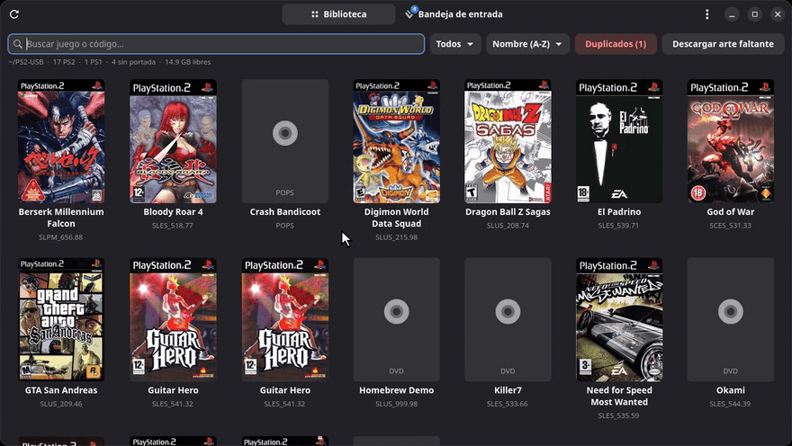
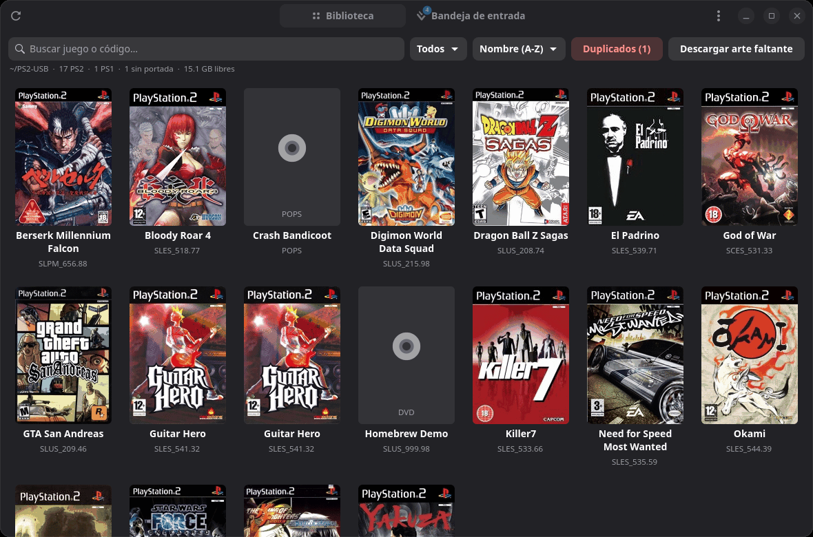
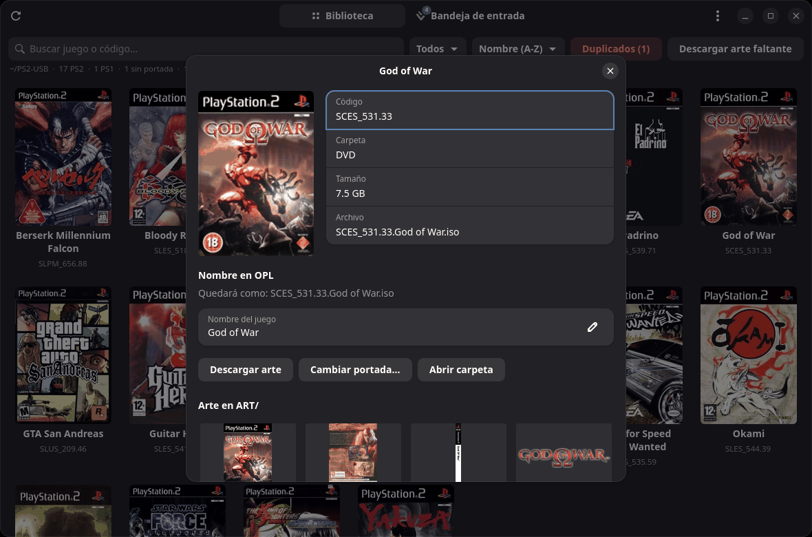
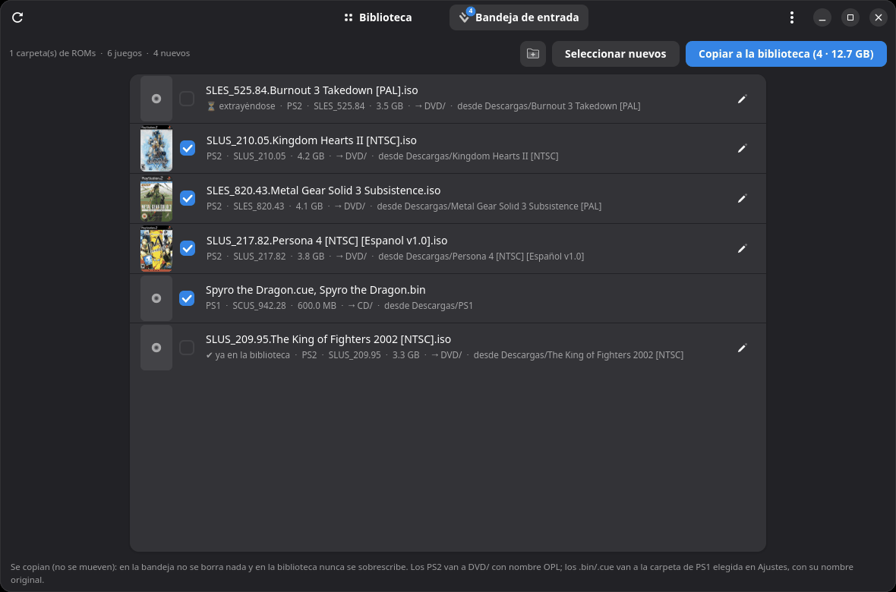
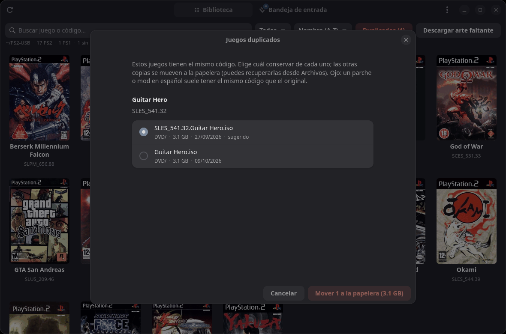
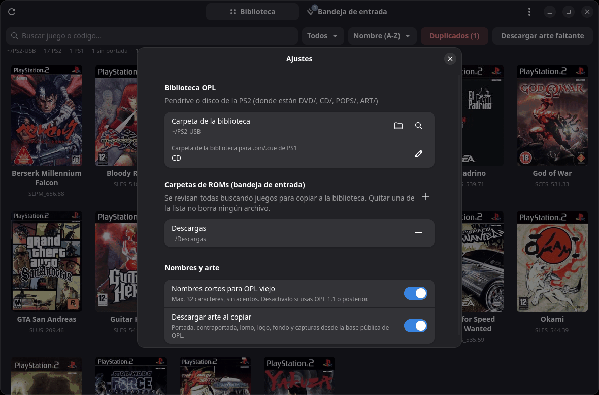

# OPL Manager para Linux

Gestor de bibliotecas de **Open PS2 Loader (OPL)** para Linux, al estilo de OPL Manager de Windows.
Hecho en Python con **GTK 4 + libadwaita**, así que se ve nativo en GNOME.

[](https://github.com/CamiloFerreira/opl-manager-linux/actions/workflows/ci.yml)
[](https://github.com/CamiloFerreira/opl-manager-linux/releases/latest)



## Video

[](https://www.youtube.com/watch?v=BAgfz78AL18)

**[▶ Ver la demo completa en YouTube](https://www.youtube.com/watch?v=BAgfz78AL18)** (2 min, con narración)

## Capturas



| Detalle de un juego | Bandeja de entrada |
|---|---|
|  |  |
| **Duplicados** | **Ajustes** |
|  |  |

<sub>Capturas y video hechos con una biblioteca de demostración.</sub>

## Qué hace

**Biblioteca** (el pendrive o disco de la PS2):
- Grilla con las portadas de tus juegos, búsqueda por nombre o código y orden por nombre, código, tamaño o fecha.
- Filtro de juegos sin portada y botón para **descargar todo el arte que falte**: portada, contraportada,
  lomo, logo, ícono, fondo y capturas, con los nombres que usa OPL (`ART/SLUS_209.46_COV.png`…).
- Al hacer clic en un juego: renombrarlo al formato OPL, bajar su arte o cambiarle la portada.
- **Duplicados**: detecta ISOs con el mismo código y te deja elegir cuál conservar; las demás van a la papelera.
- **Clic derecho en un juego**: ver detalles, cambiar nombre, descargar arte, cambiar portada, abrir carpeta,
  copiar el nombre del archivo o moverlo a la papelera (opcionalmente con su arte).

**Bandeja de entrada** (tus carpetas de ROMs: descargas, colección en el equipo…):
- Lee el código de cada juego directamente del disco (`SYSTEM.CNF`) y distingue PS2 de PS1.
- Marca los que ya tienes en la biblioteca y los que todavía se están extrayendo.
- Copia los juegos de PS2 a `DVD/` con nombre OPL (`SLUS_209.46.Nombre.iso`, opcionalmente corto para OPL viejo),
  y los `.bin`/`.cue` de PS1 a la carpeta que elijas. También lleva la portada local y descarga el arte.
- **Limpiar** (botón 🗑): mueve a la papelera los juegos que ya copiaste o los que selecciones. Si el juego está en su
  propia carpeta, se va la carpeta entera (con sus `.url`, `.txt`, portadas…). También puede hacerlo solo después de
  cada copia, siempre comprobando antes que la copia quedó completa.
- Selección rápida (nuevos, todos, ya copiados, ninguno) y clic derecho en cada juego: copiar solo ese, cambiar
  nombre, abrir carpeta o moverlo a la papelera.

**Ventana**:
- Se adapta a cualquier tamaño, hasta el de un teléfono (las pestañas pasan abajo y las barras se reacomodan).
- **Al cerrarla queda en la bandeja del sistema** (ícono en la barra superior): un clic la vuelve a abrir y su menú
  tiene *Mostrar*, *Bandeja de entrada*, *Buscar actualizaciones* y *Salir*. Mientras copia, el ícono muestra el
  progreso. Para cerrarla del todo: *Salir* (también en el menú ☰ o con Ctrl+Q). En GNOME necesita la extensión
  AppIndicator, que Ubuntu trae activada; se puede desactivar en Ajustes → Ventana.
- Sin bandeja del sistema: si la cierras mientras copia, la copia sigue en segundo plano y te avisa al terminar.

**Unidades**:
- Busca sola el pendrive o disco con OPL conectado, y avisa cuando conectas uno.
- Advierte si la unidad es FAT32 (máximo 4 GB por archivo).

**Actualizaciones automáticas**:
- Al abrir, como máximo una vez al día, busca versiones nuevas en los releases de GitHub.
- Si instalaste el ejecutable (`install.sh` o descarga directa), la versión nueva se descarga, se verifica con
  su SHA256 y se instala sola: solo tienes que pulsar **Reiniciar**.
- Si instalaste el `.deb`, te avisa y la instala con tu contraseña.
- Se puede desactivar en Ajustes → Actualizaciones, o buscar a mano en el menú ☰ → *Buscar actualizaciones*.

## Seguridad
- En la biblioteca nunca se borra ni se sobrescribe nada sin preguntar. Al cambiar una portada, la anterior queda como `.bak`.
  Los duplicados van a la papelera, no se borran.
- La bandeja no se modifica al copiar: los juegos se **copian**, no se mueven. Solo se limpia cuando tú lo pides,
  siempre con confirmación y a la papelera; si la unidad no tiene papelera, pregunta antes de borrar definitivamente.
- Cada copia se escribe como `.part` y solo se renombra al terminar completa.

## Instalar

Descarga la última versión desde **[Releases](https://github.com/CamiloFerreira/opl-manager-linux/releases/latest)**.

**Ubuntu / Debian / Linux Mint / Pop!_OS** (instala las dependencias solo):
```bash
sudo apt install ./opl-manager_*_all.deb
```

**Cualquier distro** — ejecutable de un archivo. Necesita Python 3.10+, GTK 4, libadwaita 1.5+, PyGObject y Pillow:
```bash
# Fedora:  sudo dnf install python3-gobject gtk4 libadwaita python3-pillow
# Arch:    sudo pacman -S python-gobject gtk4 libadwaita python-pillow
chmod +x opl-manager && ./opl-manager
```

**Desde el código:**
```bash
git clone https://github.com/CamiloFerreira/opl-manager-linux.git
cd opl-manager-linux
./install.sh            # ejecutable en ~/.local/bin/opl-manager + entrada en el menú
./install.sh --quitar   # desinstalar (la configuración se conserva)
python3 opl_manager.py  # o ejecutar sin instalar
```

## Desarrollo
```bash
python3 -m unittest discover -s tests -v   # pruebas
./packaging/make-release.sh                # construye .deb, ejecutable, .tar.gz y SHA256SUMS en dist/release/
```
Para publicar una versión: cambia `__version__` en `oplcore.py`, haz commit y sube un tag `vX.Y.Z`;
GitHub Actions construye los paquetes y crea el release.

## Configuración
Menú ☰ → Ajustes: biblioteca OPL, carpetas de ROMs, carpeta para PS1, nombres cortos (máx. 32 caracteres para OPL viejo)
y descarga automática de arte. Se guarda en `~/.config/opl-manager/config.json`.

## Créditos
- Arte de los juegos: [psx-ps2-opl-art-database](https://github.com/Luden02/psx-ps2-opl-art-database).
- [Open PS2 Loader](https://github.com/ps2homebrew/Open-PS2-Loader).

## Pendiente
- Convertir PS1 (`.bin`/`.cue`) a `.VCD` para POPS.
- Arte para juegos de PS1.

## Licencia
MIT. Ver [LICENSE](LICENSE).
